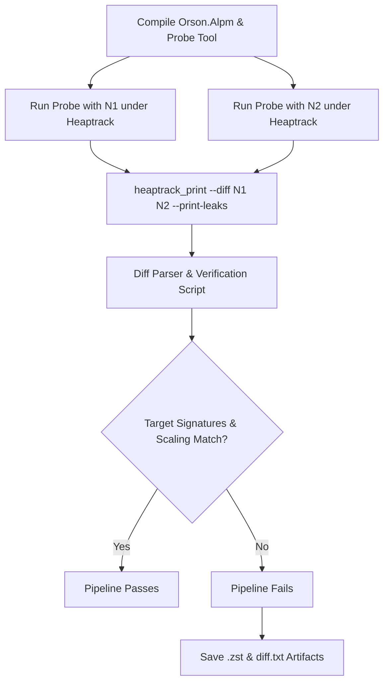

# Heaptrack Testing Pipeline Design Plan

Date: 2026-11-20

## 1. Executive Summary

This plan defines an automated native memory leak detection pipeline for `Orson.Alpm`.
The pipeline uses heaptrack to detect and diagnose native memory leaks.
It replaces process-wide `mallinfo2` assertions removed from the test suite.
The pipeline isolates leak detection from the unit test runner.
It uses differential analysis between two runs with different iteration counts.
The pipeline asserts allocation-site signatures and linear call-count scaling.
It does not gate on process-wide total leaked bytes.

---

## 2. Technical Background and Findings

This section consolidates findings from previous investigations.

### 2.1 The `CFreeExtern` Interposition Defect

Upstream heaptrack (version 1.5.0 and master) hooks `malloc`, `free`, `realloc`, and `calloc`.
Heaptrack does not hook `dlsym` or `dlvsym`.
CoreCLR resolves direct `[LibraryImport("libc", EntryPoint = "free")]` via `dlsym` on the libc handle.
This lookup bypasses `LD_PRELOAD` interposition.
CoreCLR caches the concrete libc function pointer.
When `alpm_list_free_inner` calls `CFreeExtern`, it executes the uninstrumented libc `free`.

This bypass caused two critical issues:
1. Under heaptrack, sound executions reported false leaks. Clean runs reported 1.01 MB over 72,000 unreleased `__strdup` allocations.
2. Under mimalloc, direct libc `free` corrupted the heap. It aborted execution with exit code 139.

The solution sets an assembly-level `DllImportResolver` in `Orson.Alpm`.
The resolver maps `libc` lookups to `NativeLibrary.GetMainProgramHandle()`.
On Linux, this pseudo-handle queries symbols globally with `RTLD_DEFAULT` search order.
Global resolution routes deallocations through the preloaded wrapper.
Subsequent calls use the cached pointer and incur no per-call symbol lookup overhead.
The Cdecl callback ABI for `alpm_list_free_inner` remains unchanged.

### 2.2 Removal of `mallinfo2`

The `mallinfo2` API reports glibc allocator state across the entire process.
It exhibits three fatal flaws for automated leak detection:
1. It is glibc-specific and reports zero under alternative allocators such as mimalloc.
2. Background runtime activity moves process counters unpredictably.
3. It cannot identify the leaking allocation site or call stack.

All `mallinfo2` declarations, `NativeHeapInUse` helpers, and heap-growth assertions are removed.

### 2.3 Heaptrack Profiling Semantics and Boundaries

Heaptrack records native allocation events through `LD_PRELOAD`.
It records allocation size, pointer value, and native call backtraces.
Heaptrack records deallocations by pointer value.
At program exit, heaptrack reports unreleased allocations as leaked memory.
Heaptrack does not perform reachability scans.
Global allocations, runtime caches, and static data remain recorded as leaked.

Consequently:
- `total memory leaked == 0` is invalid for .NET processes.
- CoreCLR, JIT compilation, and runtime infrastructure introduce baseline noise.
- Heaptrack does not track memory access errors, buffer overflows, use-after-free, or double-free.
- Heaptrack does not intercept `strdup` or `strndup` when provided by mimalloc.
- Native stack frames resolve via ELF symbols and DWARF unwind tables.
- Managed .NET frames do not reliably symbolize in native backtraces.

---

## 3. Differential Testing Methodology ($N_1$ vs $N_2$)

The pipeline uses differential analysis to eliminate runtime noise.

```
       +-----------------------+       +-----------------------+
       |   Run 1: Low Count    |       |   Run 2: High Count   |
       |      Iterations: N1   |       |      Iterations: N2   |
       +-----------+-----------+       +-----------+-----------+
                   |                               |
                   v                               v
             profile_n1.zst                  profile_n2.zst
                   \                               /
                    \                             /
                     v                           v
              +-----------------------------------------+
              |   heaptrack_print --diff N1 N2 --leaks   |
              +--------------------+--------------------+
                                   |
                                   v
                             diff_report.txt
                                   |
                                   v
             +-------------------------------------------+
             | Assert Target Site & Scaling: (N2 - N1)   |
             +-------------------------------------------+
```

### 3.1 Execution Principle

1. Run the test probe with low iteration count $N_1$ (for example, 1,000 iterations).
2. Run the test probe with high iteration count $N_2$ (for example, 10,000 iterations).
3. Ensure both runs execute identical initialization and warm-up cycles.
4. Compare profiles using `heaptrack_print --diff profile_n1.zst profile_n2.zst --print-leaks`.

### 3.2 Noise Cancellation

Constant runtime allocations occur during startup and warm-up.
In the differential calculation, constant allocations subtract to zero ($1 - 1 = 0$).
True leaks scale directly with iteration count:
$$\Delta \text{Allocations} = (N_2 - N_1) \times \text{AllocationsPerIteration}$$
$$\Delta \text{Bytes} = (N_2 - N_1) \times \text{BytesPerIteration}$$

The pipeline asserts against this delta.
It ignores non-scaling runtime allocations.

---

## 4. Test Scenario Matrix

The pipeline executes five maintained scenarios:

| Scenario Name | Description | Production Path Used | Expected Target Leak Delta |
|---|---|---|---|
| `Control_Clean` | Materialize list and release with `AlpmStringList.TakeOwned` | Yes | Zero target leaks |
| `Leak_InnerStrings` | Release list nodes but omit element string release | Yes (omits string free) | String allocations scale with $\Delta N$ |
| `Leak_ListNodes` | Unlink strings but omit `alpm_list_t` node release | Yes (omits node free) | List node allocations scale with $\Delta N$ |
| `Leak_MmapLargeChunk` | Allocate large transient buffers and omit cleanup | Yes (omits allocator dispose) | Heap chunk allocations scale with $\Delta N$ |
| `Leak_RareOrSmall` | Inject a leak once every 5,000 iterations | Yes (periodic omission) | Small leak detected despite JIT noise |

### 4.1 Scenario Verification Criteria

- In `Control_Clean`, `libalpm` and `__strdup` allocation sites must report zero leaked allocations.
- In `Leak_InnerStrings`, `__strdup` in `alpm_list_append_strdup` must scale by $(N_2 - N_1) \times \text{Count}$.
- In `Leak_ListNodes`, `alpm_list_add` in `libalpm.so` must scale by $(N_2 - N_1) \times \text{Count}$.
- In `Leak_MmapLargeChunk`, large allocations must scale by $(N_2 - N_1) \times \text{ChunkCount}$.
- In `Leak_RareOrSmall`, target allocation sites must match expected scaling within tolerance.

---

## 5. Pipeline Architecture and Implementation



### 5.1 Dedicated Probe Executable

Do not run heaptrack against xUnit.
The test runner introduces multi-threading and dynamic assembly loading noise.
Create a dedicated console executable: `Orson.NativeLeakProbe`.

The probe contract:
- Subcommand: `Orson.NativeLeakProbe <scenario> <iterations>`
- Scenarios: `clean`, `inner`, `nodes`, `mmap`, `rare`
- Arguments specify positive integer iterations.
- The executable performs deterministic warm-up before entering the measured loop.
- The executable exits with code 0 on success.

### 5.2 Test Runner and Analyzer

Implement an automation driver in Python or .NET: `tools/run-heaptrack-tests`.

Execution steps:
1. Parse CLI arguments and locate installed `heaptrack` and `heaptrack_print`.
2. For each scenario:
   - Execute: `heaptrack --record-only -o /tmp/heaptrack_n1 ./Orson.NativeLeakProbe <scenario> 1000`
   - Execute: `heaptrack --record-only -o /tmp/heaptrack_n2 ./Orson.NativeLeakProbe <scenario> 10000`
   - Execute: `heaptrack_print --diff /tmp/heaptrack_n1.zst /tmp/heaptrack_n2.zst --print-leaks > /tmp/diff.txt`
3. Parse the `MEMORY LEAKS` block in `/tmp/diff.txt`.
4. Extract allocation count and byte size for target stack symbols (`libalpm.so`, `__strdup`).
5. Assert expected values against actual values.
6. Return exit code 0 when all assertions pass.

### 5.3 Diagnostic Artifact Retention

The pipeline retains failure evidence for developers.
When an assertion fails:
1. Retain the generated `diff.txt`.
2. Retain both raw `.zst` profile dumps.
3. Log the extracted leak values and expected bounds.
4. Upload artifacts to CI storage.
Developers can inspect raw profiles directly using `heaptrack_gui`.

---

## 6. Constraints and Maintenance Rules

1. **Version Pinning**:
   - Pin heaptrack to version 1.5.0 in the CI container environment.
   - `heaptrack_print` generates human-readable text without schema guarantees.
   - Fail immediately if `heaptrack_print` produces unparseable output.

2. **Debug Symbols**:
   - Ensure debug symbols exist for `libalpm.so` and `libc.so.6`.
   - Without symbols, stack matching falls back to raw offsets, which break across updates.

3. **CI Scheduling**:
   - Run standard unit tests on every pull request.
   - Schedule the heaptrack pipeline on a nightly cadence or on changes to `src/Orson.Alpm/Interop/`.
   - Native tracing adds CPU and I/O overhead; do not run on every quick commit.
